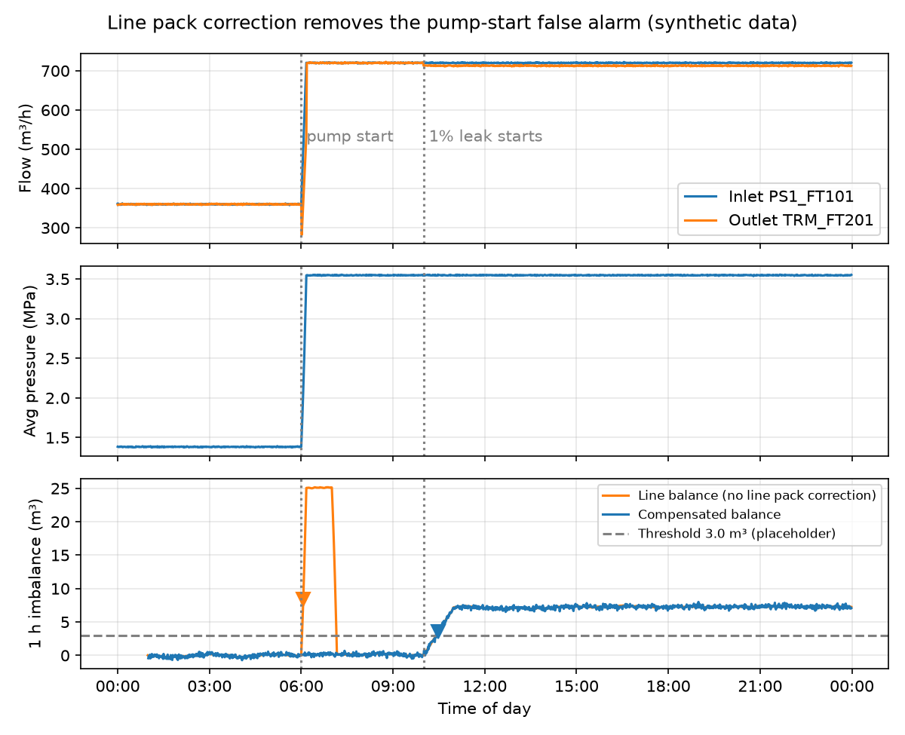

# Leak Detection Simulator

A compensated volume balance (CPM) leak detector in Python, tested on synthetic SCADA-style data from a made-up 100 km crude oil line. I built it as self-study to learn how computational pipeline monitoring works, and assessed it against the four performance measures in API RP 1130.

**Synthetic data only.** The data comes from my own simplified hydraulic model, not a real SCADA system, and the detector is my own code, not a commercial CPM platform. The results show how the method behaves under my assumptions. They are not a validation of any real pipeline.

Two-page summary: [report/Leak_Detection_Simulator_Memo.pdf](report/Leak_Detection_Simulator_Memo.pdf)

## Results



- **Line pack correction removes pump-start false alarms.** A pump start packs about 25 m³ into the line. The plain in minus out balance counted that as missing oil and alarmed; the compensated balance stayed under 0.7 m³. Both caught the 1% leak.
- **Sensitivity.** With tuned thresholds, the 1 hour window caught a 1% leak in a median of 8 minutes and caught every 0.5% leak.
- **Meter bias sets the floor.** Bias adds the same volume every minute, just like a leak, so no window length beats it. The smallest detectable leak levels off near the 0.1% bias allowance.
- **Reliability.** Over 7 days of pump starts and valve moves with no leak, the plain balance raised 1.14 false alarms per day; the compensated balance raised none.
- **Robustness.** Up to 10 s of outlet clock skew caused no false alarms (they started around 30 s). A 2 m³/h reporting deadband on the flow meters caused 76 false alarms in the 1 hour window over 21 days; 0.5 m³/h caused none.

Full tables: [results/summary.md](results/summary.md)

## Method

```
Imbalance = Σ(Q_in − Q_out)·Δt − ΔLP

ΔLP = V·(1/K + D/(E·t))·ΔP_avg − V·β·ΔT_avg
```

- Line pack for this pipe: 11.52 m³ per MPa of average pressure (about 74% oil compression, 26% pipe stretch) and 9.59 m³ per °C.
- Windows of 5 minutes, 1 hour and 24 hours, evaluated every minute. An alarm needs 3 minutes in a row over the threshold.
- Threshold = bias allowance (0.1% of flow) + 3 × the standard deviation of the imbalance, measured from a 7 day no-leak run.
- 15 minute alarm inhibit after a pump or valve status change. Data quality checks (missing, frozen, out of range) run before the balance.

## Test pipeline

| Parameter | Value |
|---|---|
| Length | 100 km, flat |
| Pipe | NPS 16: OD 406.4 mm, wall 7.9 mm, ID 390.6 mm |
| Fluid | Crude oil, 850 kg/m³, 10 cSt, K = 1.4 GPa, β = 8 × 10⁻⁴ per °C |
| Normal flow | 0.20 m³/s (720 m³/h) |
| Friction loss at normal flow | 6.10 MPa (Darcy-Weisbach, Swamee-Jain) |
| Instruments | Flow meters at both ends (`PS1_FT101`, `TRM_FT201`); pressure at 0, 50 and 100 km; temperature at both ends |

## Files

| File | What it does |
|---|---|
| `generator.py` | Pipeline parameters, hydraulics, and the synthetic data generator (leaks, pump starts, meter errors, faults) |
| `cpm.py` | The volume balance, thresholds, persistence and inhibit |
| `quality.py` | Data quality checks |
| `run_tests.py` | Runs every test case and writes `results/` and `report/figures/` |
| `LOG.md` | My working log |

## How to run

```
pip install numpy pandas matplotlib
python generator.py
python run_tests.py
```

## Limitations

Flat line with no slack-line conditions; one fluid with fixed properties; each minute treated as settled, so no pressure waves; meter errors modelled as constant bias plus random noise; the leak doesn't change the pressures. A real system also has to handle batches, shut-in conditions, meter proving, SCADA communications at scale, controller response procedures and leak location.

## References

Studied from public summaries; the standards themselves are paywalled.

- API RP 1130, *Computational Pipeline Monitoring for Liquids*, 2nd ed. (2022)
- API TR 1149, *Pipeline Variable Uncertainties and Their Effects on Leak Detectability*, 2nd ed. (2015)
- API RP 1175, *Pipeline Leak Detection: Program Management*, 2nd ed. (2022)
- CSA Z662, *Oil and Gas Pipeline Systems*, Annex E
